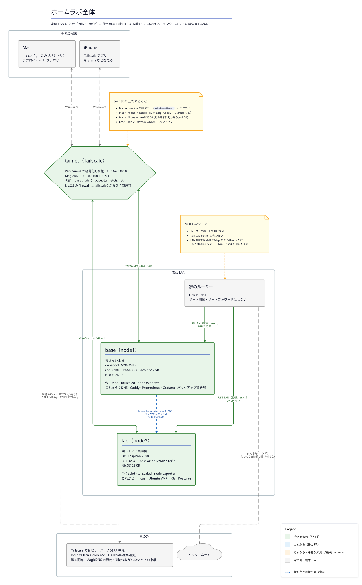
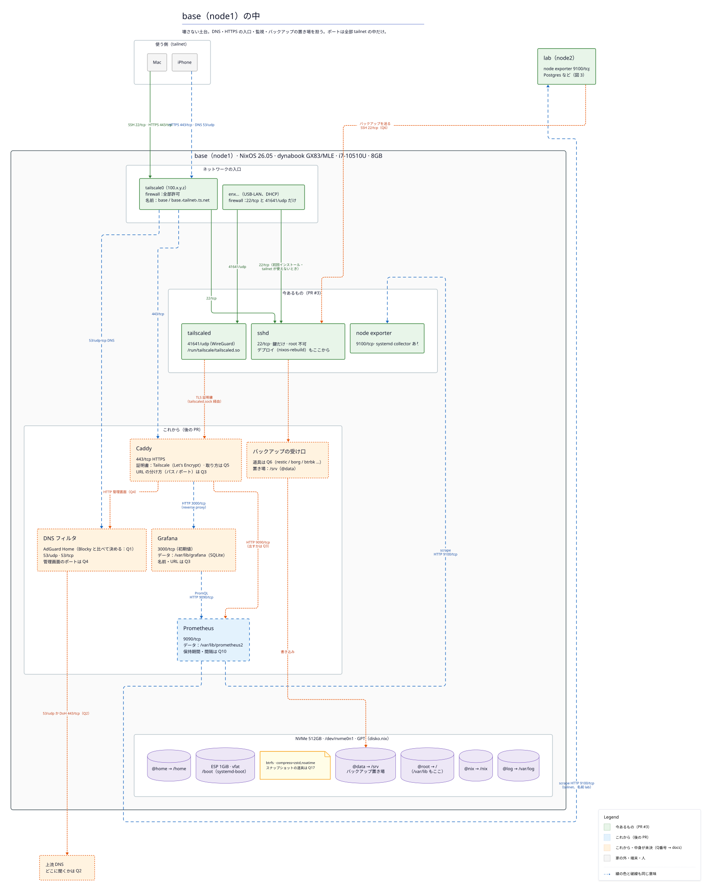
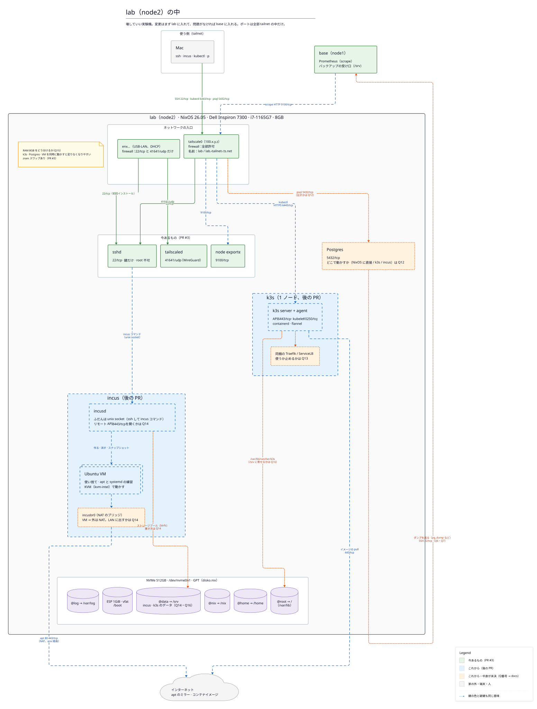
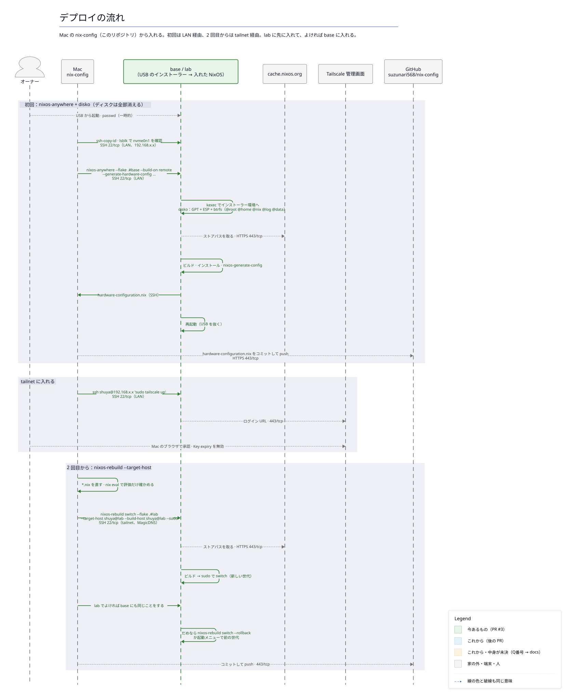
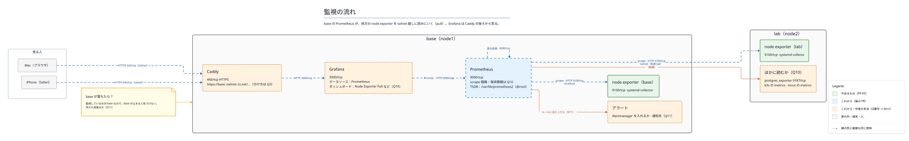
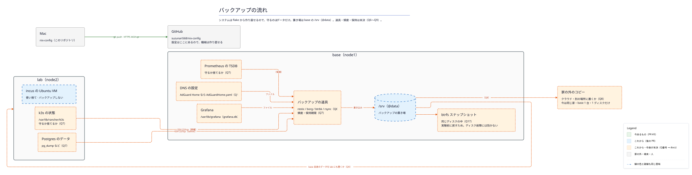

# ホームラボの設計図（下書き）

ホームラボ（`base` / `lab`）の設計図です。**下書き**なので、見てもらいながら詰めていきます。
インストール手順は [homelab.md](homelab.md) にあります。

図は C4 モデルの考え方で、**全体 → 1 台ずつ → 流れ** の順に細かくしています。

| 段 | 図 | ソース |
| --- | --- | --- |
| 全体 | [1. ホームラボ全体](#1-全体) | [`design/01-overview.d2`](design/01-overview.d2) |
| 1 台 | [2. base の中](#2-base-の中) | [`design/02-base.d2`](design/02-base.d2) |
| 1 台 | [3. lab の中](#3-lab-の中) | [`design/03-lab.d2`](design/03-lab.d2) |
| 流れ | [4. デプロイ](#4-デプロイの流れ) | [`design/04-deploy.d2`](design/04-deploy.d2) |
| 流れ | [5. 監視](#5-監視の流れ) | [`design/05-monitoring.d2`](design/05-monitoring.d2) |
| 流れ | [6. バックアップ](#6-バックアップの流れ) | [`design/06-backup.d2`](design/06-backup.d2) |

## 図の読み方

| 見た目 | 意味 |
| --- | --- |
| 緑・実線 | 今あるもの（PR #3 で入るもの） |
| 青・破線 | これから（後の PR で足す）。中身は決まっている |
| 橙・細かい破線 | これから、かつ中身がまだ決まっていない。図の中の **Q 番号** は下の「[まだ決めていないこと](#まだ決めていないこと)」の番号 |
| 灰 | 家の外のもの・手元の端末・人 |
| 線のラベル | `ポート/プロトコル` と、何のための通信か |

決めていないことは、図の中では推測で埋めずに「Q 番号」だけを書いています。

## 1. 全体



- 2 台とも USB-LAN で家のルーターにつなぎ、IP は DHCP でもらいます。Wi-Fi は使いません。
- Mac・iPhone・base・lab はどれも Tailscale の tailnet に入ります。サービスを使うのは tailnet の中からだけです。名前は MagicDNS（`base` / `lab`）で引きます。
- **インターネットには公開しません。** ルーターでポートを開けず、Tailscale Funnel も使いません。外へ向かう通信（Tailscale の管理サーバー、cache.nixos.org、apt など）だけです。
- LAN 側の firewall で開いているのは SSH（22/tcp）と Tailscale（41641/udp）だけで、`tailscale0` からは全部通します（PR #3 の `modules/nixos/common.nix`）。

## 2. base の中



- **今あるもの**：sshd、tailscaled、node exporter（9100/tcp）。
- **これから**：
  - **DNS フィルタ**（AdGuard Home を考えている。Blocky と比べて決める：Q1）。53/udp・53/tcp。
  - **Caddy**：HTTPS（443/tcp）の入口。証明書は Tailscale から取る（`base.‹tailnet›.ts.net` の Let's Encrypt 証明書）。後ろに Grafana などを置く。
  - **Prometheus**（9090/tcp）と **Grafana**（3000/tcp）：監視（図 5）。
  - **バックアップの受け口**：置き場は `/srv`（btrfs の `@data`）。道具は未決（Q6）。
- **ディスク**（PR #3 の `hosts/base/disko.nix`）：`/dev/nvme0n1` に GPT。ESP（1GiB、vfat、`/boot`）と btrfs（`compress=zstd,noatime`）。サブボリュームは `@root`（`/`）、`@home`、`@nix`、`@log`（`/var/log`）、`@data`（`/srv`）。
- NixOS のサービスの多くは `/var/lib/…` にデータを置くので、今のままだと `@root` に入ります。`/srv` に寄せるかは Q16。

## 3. lab の中



- **今あるもの**：sshd、tailscaled、node exporter。base と同じ共通設定です。
- **これから**：
  - **incus**：Ubuntu の VM を作っては消す。apt と systemd の練習用。VM は KVM で動かす。ふだんは lab に ssh して `incus` コマンドを使う。
  - **k3s**：1 ノード（server と agent が同じ機械）。API は 6443/tcp。
  - **Postgres**：5432/tcp。どこで動かすかは Q12。
- ディスクは base と同じ構成です。incus のストレージプール（btrfs）と k3s のデータの置き場は Q14・Q16。
- RAM が 8GB なので、k3s・Postgres・VM を同時に動かすと足りなくなりやすいです（Q15）。zram スワップは PR #3 で入っています。

## 4. デプロイの流れ



- **初回**：USB のインストーラーで起動 → Mac から LAN 越しに SSH → `nixos-anywhere`（`--build-on remote`）が kexec して disko でディスクを作り、NixOS を入れる。`hardware-configuration.nix` は実機で作って Mac に持ってきて、コミットする。
- **tailnet に入れる**：`sudo tailscale up` → Mac のブラウザで承認 → Key expiry を無効にする。
- **2 回目から**：Mac で `*.nix` を直して `nix eval` で評価を確かめ、`nixos-rebuild switch --target-host … --build-host … --sudo` で反映する（SSH 22/tcp、tailnet 越し）。Mac（aarch64-darwin）では x86_64-linux をビルドできないので、ビルドは相手の機械でする。
- 入れる順番は **lab → base**。だめなら `nixos-rebuild switch --rollback` か起動メニューで前の世代に戻す。
- コマンドの詳細は [homelab.md](homelab.md) の 4〜6 にあります。

## 5. 監視の流れ



- base の Prometheus が、base の node exporter（localhost:9100）と lab の node exporter（`lab:9100`、tailnet 越し）を読みにいきます（pull）。node exporter は firewall で開けていないので、tailnet の中からしか届きません。
- Grafana は Prometheus をデータソースにして、Caddy の後ろから見ます（Mac・iPhone → HTTPS 443/tcp）。
- Postgres・k3s・incus などを読むか、アラートをどこへ送るかは未決（Q10・Q11）。
- 監視しているのが base なので、**base が止まると気づけません**（Q11）。

## 6. バックアップの流れ



- 機械の設定は全部この flake（GitHub の `suzunari568/nix-config`）にあるので、作り直せます。守るのは **データ** だけです。
- 置き場は base の `/srv`（`@data`）です。
- 候補のデータ：lab の Postgres、k3s の状態、base の Grafana・DNS の設定・Prometheus の TSDB。どれを守るかは Q7。
- incus の Ubuntu VM は使い捨てなので、バックアップしません。
- btrfs のスナップショットは「実験の前に戻す」ためのもので、同じディスクの中なのでディスクの故障には効きません。
- 今のままだと、バックアップは **家の中の base 1 台・1 ディスク** にしかありません（Q8・Q9）。

## ポートの表

「誰から」は firewall の上で届く範囲です。`tailscale0` は全部許可なので、tailnet の中からは基本的にどのポートにも届きます。外に出したくないものは、サービス側で `127.0.0.1` に bind するかを決めます（Q3）。

| ホスト | サービス | ポート | 誰から | 状態 |
| --- | --- | --- | --- | --- |
| base・lab | sshd | 22/tcp | LAN・tailnet | 今ある |
| base・lab | tailscaled（WireGuard） | 41641/udp | LAN（ほかの Tailscale の機械） | 今ある |
| base・lab | node exporter | 9100/tcp | tailnet だけ | 今ある |
| base | DNS（AdGuard Home か Blocky：Q1） | 53/udp・53/tcp | tailnet（どの端末に効かせるかは Q2） | これから |
| base | DNS の管理画面 | 未定（AdGuard Home の初期値 3000 は Grafana と重なる：Q4） | Caddy 経由 | これから |
| base | Caddy | 443/tcp | tailnet | これから |
| base | Prometheus | 9090/tcp | Grafana（localhost）。外に出すかは Q3 | これから |
| base | Grafana | 3000/tcp（初期値） | Caddy 経由 | これから |
| lab | k3s API | 6443/tcp | tailnet（Mac の kubectl） | これから |
| lab | kubelet | 10250/tcp | lab の中 | これから |
| lab | Postgres | 5432/tcp | 出すかは Q12 | これから |
| lab | incus のリモート API | 8443/tcp | 開くかは Q14 | これから |
| （Tailscale） | MagicDNS | 100.100.100.100:53 | 各機械の中 | 今ある |
| （外向き） | Tailscale の制御・DERP | 443/tcp、3478/udp（STUN） | 外へ出るだけ | 今ある |
| （外向き） | cache.nixos.org・apt・イメージ | 443/tcp（apt は 80/tcp も） | 外へ出るだけ | 今ある／これから |

## 名前の表

| 名前 | 何か | 状態 |
| --- | --- | --- |
| `base` | node1、dynabook GX83/MLE。`nixosConfigurations.base` | 今ある |
| `lab` | node2、Dell Inspiron 7300。`nixosConfigurations.lab` | 今ある |
| `base.‹tailnet›.ts.net` / `lab.‹tailnet›.ts.net` | MagicDNS の長い名前。Caddy の証明書もこの名前で取る | 今ある（証明書はこれから） |
| `shuya` | 2 台共通のユーザー（wheel、sudo はパスワードなし） | 今ある |
| `tailscale0` | Tailscale のインターフェース（firewall で全部許可） | 今ある |
| `enx…` | USB-LAN のインターフェース（名前は MAC アドレスから） | 今ある |
| `@root` `@home` `@nix` `@log` `@data` | btrfs のサブボリューム（`/`、`/home`、`/nix`、`/var/log`、`/srv`） | 今ある |
| `incusbr0` | incus の NAT ブリッジ（初期値の名前） | これから |
| Grafana などの URL | `https://base.‹tailnet›.ts.net/…` のどこに置くか | 未決（Q3） |

## まだ決めていないこと

| # | 何を決めるか | 候補・考えること |
| --- | --- | --- |
| Q1 | DNS フィルタの道具 | AdGuard Home（Web UI で設定、NixOS モジュールあり）か Blocky（設定が全部 Nix で書ける、UI なし） |
| Q2 | DNS をどの端末に効かせるか・上流 | Tailscale 管理画面の DNS 設定で base を指す（tailnet の端末だけ）か、家のルーターの DHCP で配るか。上流はどこか（普通の 53/udp か DoH）。base が止まったときに名前が引けなくなる問題をどうするか |
| Q3 | Grafana などの名前・URL の分け方 | Tailscale の証明書はマシン名ごと（`base.‹tailnet›.ts.net`）でサブドメインが使えない。パスで分ける（`/grafana`）か、ポートで分けるか、Tailscale の別の仕組みを使うか。Prometheus や DNS の管理画面も出すか。各サービスを `127.0.0.1` に bind するか |
| Q4 | DNS の管理画面のポート | AdGuard Home の初期値 3000/tcp は Grafana と重なる |
| Q5 | Caddy が Tailscale の証明書を取る方法 | Caddy の Tailscale 連携（tailscaled のソケットを読む権限を Caddy に渡す）か、`tailscale cert` を定期的に実行して渡すか。管理画面で HTTPS 証明書を有効にする必要がある。証明書の名前は Certificate Transparency のログで公開される |
| Q6 | バックアップの道具 | restic / borg / btrbk（btrfs send）/ rsync |
| Q7 | 何を・どのくらいの頻度で・どれだけ残すか | Postgres（pg_dump か物理バックアップか）、k3s の状態、Grafana、DNS の設定、Prometheus の TSDB を守るか。`/home` は対象か |
| Q8 | 家の外にコピーを置くか | クラウドのストレージ・別の場所。今は同じ家の base 1 台・1 ディスクだけ |
| Q9 | base 自身のデータの置き場 | base のデータを base の `/srv` に置いても、ディスク故障には効かない。lab にもコピーを置くか |
| Q10 | Prometheus の設定 | scrape の間隔、保持期間（ディスクの量）、追加で読むもの（postgres_exporter、k3s、incus、Caddy）、Grafana のダッシュボード |
| Q11 | アラート | Alertmanager を入れるか、通知先（メール・ntfy・Discord など）。base が止まったことにどう気づくか |
| Q12 | Postgres をどこで動かすか・何に使うか | lab の NixOS に直接か、k3s の中か、incus の中か。tailnet に出すか |
| Q13 | k3s の同梱物 | Traefik と ServiceLB を使うか止めるか。tailnet からアプリにどう入るか |
| Q14 | incus の作り | ストレージプール（`/srv` の下に btrfs で作るか）、VM のネットワーク（`incusbr0` の NAT か LAN にブリッジか）、リモート API・Web UI を出すか。k3s と incus の firewall（nftables）やブリッジがぶつからないか |
| Q15 | lab の RAM 8GB の分け方 | k3s・Postgres・VM の上限をどうするか、同時に動かすか |
| Q16 | サービスのデータの置き場 | `/var/lib/…`（`@root`）のままにするか、`/srv`（`@data`）に寄せるか |
| Q17 | btrfs のスナップショット | 道具（snapper / btrbk）・頻度・残す数。どのサブボリュームを撮るか |
| Q18 | LAN の IP を固定するか | ルーターで DHCP の予約をするか。LAN の IP を使うのは初回インストールと、Q2 でルーターから DNS を配る場合 |
| Q19 | Tailscale の ACL・Tailscale SSH | iPhone から何に届いてよいか。Tailscale SSH を使うか、今の sshd（鍵）のままか |
| Q20 | シークレットの管理 | Grafana の管理者パスワードなどを sops-nix か agenix で持つか |

## 図の直し方

D2（<https://d2lang.com>）で書いています。`docs/design/*.d2` を直したら、SVG を書き出し直してコミットします。

```sh
docs/design/render.sh                  # docs/design/*.svg を書き出す
docs/design/render.sh png /tmp/design  # 見た目の確認用に PNG を書き出す（コミットしない）
```

- レイアウトは `elk` です（`tala` はライセンスが要るので使いません）。
- 色と線の種類は [`design/_style.d2`](design/_style.d2) にまとめていて、各図の先頭で読み込んでいます。
- アイコンは使っていません（外部の URL に頼らず、文字だけで読めるようにするため）。
